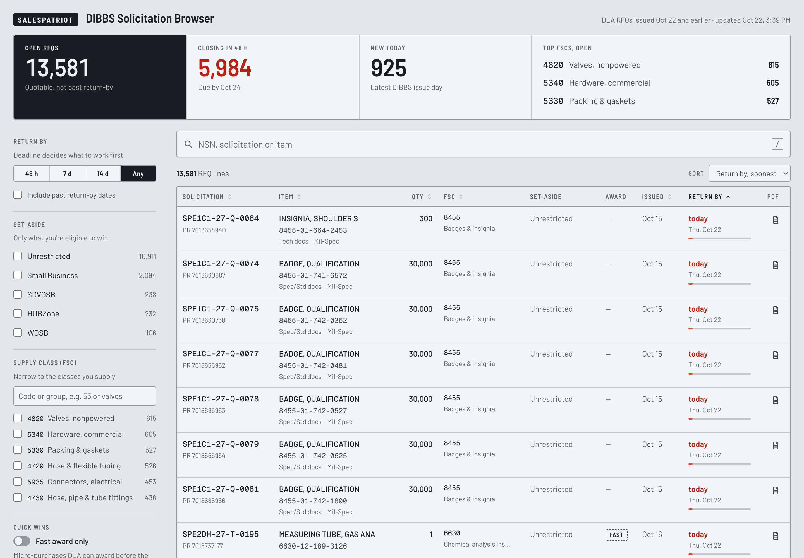

# SalesPatriot technical screen task: DIBBS Solicitation Browser

One page where a DLA vendor sees the open RFQs worth quoting today, narrows them to their supply classes and eligibility, and opens the RFQ on DIBBS to quote.



## Run it

Requires Node 24. The database isn't committed, so scrape first. 3 days take about 2 minutes; 15 days take about 15.

```sh
npm run scrape -- 15          # fill data/dibbs.db with the newest 15 DIBBS issue days
                              # or exact dates: npm run scrape -- 10-14-2026 10-13-2026
npm --prefix web install      # once
npm start                     # build and serve the page and API on http://localhost:3000
npm run dev                   # or: Next.js dev server with hot reload
npm test                      # scraper parser tests + API query builder tests
```

If `data/dibbs.db` is missing, the page and API both say to run `npm run scrape` first. Set `DIBBS_DB=/path/to/dibbs.db` to point at another file.

## Getting the data

DIBBS has no public API, and its bulk download files need a vendor login (a CAGE code plus SAM registration). So the scraper reads the same public pages a person would.

1. **Consent banner:** every DIBBS page first redirects to a DoD consent banner. The scraper posts its "OK" form and keeps the session cookie.
2. **Issue dates:** `Rfq/RfqDates.aspx?category=issue` lists them, about 28 (a month).
3. **Pages:** each day's RFQ grid is 50 rows a page. Pages 2 and on are ASP.NET postbacks, so the scraper sends back every hidden `__VIEWSTATE*` field (about 1,300 of them) with `Page$N`.
4. **Parsing:** each cell is read by its stable element ID (`_lblNsn`, `_lblSolicitation`, …), not by column position.
5. **Retries:** DIBBS drops connections now and then, so each request retries 3 times with backoff and has a 90 s timeout.
6. **Saving:** rows are upserted into SQLite. Re-running a day refreshes status and deadlines and never duplicates rows.

The current data is **26,632 RFQ lines** from 15 issue days (Oct 6–22, 2026): 24,190 solicitations, 22,732 NSNs and 362 supply classes. It took 3 parallel workers about 15 minutes, with no errors.

## Key decisions

| Decision | Why |
|---|---|
| **Scrape HTML over plain HTTP, with no headless browser** | The data doesn't need JavaScript to render. HTTP is 5–10× faster and adds no Chromium dependency. Existing paid scrapers (Apify) read the same public pages, so they offer no data advantage. |
| **One row per RFQ line, keyed by `(solicitation, pr_number, nsn)`** | Solicitation plus PR was the first guess, and real data broke it: 53 collisions in one day, because first-article and testing sub-lines share a PR. |
| **Read the solicitation and status from cell text, not links** | Solicitations whose PDF isn't posted yet have no link, and they came back blank. |
| **Store part numbers as-is, and give FSC only to real NSNs** | Some items are non-NSN part numbers (`7310GM5022323`). |
| **SQLite (built into Node 24) over Postgres** | Zero setup and zero dependencies for the scraper. 26k rows is small. One writer, many readers; WAL mode let 3 parallel scrapers share the file. Postgres is the production move (see [Implementation_step.md](Implementation_step.md)). |
| **Polite concurrency: 3 days at a time** | It's a government server that already drops connections. More parallelism risks throttling. |
| **Next.js app reading the same file read-only** | Page and API in one app. The schema stays unchanged. |
| **Filter state in the URL** | Every view can be shared and survives a reload. The page and API share one query builder, so a URL means the same thing in both. |
| **Default view = Open and not past due, soonest deadline first** | About 1 in 5 "Open" lines on DIBBS are already past their return-by date and can't be quoted. |

The data model with every column is in [Implementation_step.md](Implementation_step.md#data-structure), and the module layout is in [docs/architecture.md](docs/architecture.md).

## How it's built

- `src/`: the scraper. Plain Node 24 TypeScript, zero dependencies, writing `data/dibbs.db`. `test/` holds parser tests against 3 saved real DIBBS rows.
- `web/`: a Next.js 16 app. The route handlers read the same SQLite file read-only through `node:sqlite`.
  - `web/lib/query.ts`: the query builder. It parses and validates URL params, then builds parameterised SQL. Sort columns come from an allowlist and values never reach the SQL text. The page and the API share it, so a URL means the same thing in both.
  - `GET /api/rfqs?…` returns `{ rows, total }`, 50 rows a page.
  - `GET /api/facets?…` returns option counts for status, set-aside and FSC under the current filters (each one leaves out its own dimension), plus the global summary tiles.
  - Bad params (unknown key, bad enum, bad date, qmin > qmax, …) return `400 { error }` with the reason.
  - `web/app/browser.tsx` is the page. Filter state lives in the URL, so every view can be shared and survives a reload.
- Speed: on about 26k rows, `/api/rfqs` answers in about 20–50 ms and `/api/facets` in about 25–35 ms on a laptop, using full scans with no added indexes (the schema is unchanged).

## Filters and why

| Filter | Default | Why |
|---|---|---|
| **Return by:** 48 h / 7 d / 14 d / Any | Any upcoming date | The deadline decides what to work on first. "Any" still hides RFQs whose return-by date has passed, since you can't quote them (about 1 in 5 "Open" lines on DIBBS is already past due). A checkbox brings them back. |
| **Set-aside:** Unrestricted, Small Business, SDVOSB, HUBZone, WOSB | All | This is eligibility. A small business wants the set-asides it qualifies for plus unrestricted work, and nothing else. |
| **Supply class (FSC)**, multi-select with counts | All | Vendors specialize by supply class. Each code shows its Federal Supply Group name (5330 → Packing & gaskets; classes without a listed title show their group), and the list can be searched by code or name. |
| **Fast award only** | Off | Micro-purchases that can be awarded before the return date are quick wins. |
| **Paperwork:** tech docs (any / none / required), Mil-Spec (any / exclude / only) | Any | This is the capability and documentation burden. "No tech docs, no Mil-Spec" is the low-effort pile. |
| **Quantity** min–max | — | It shows whether a job fits your stock and production capacity. |
| **Issued** date range | — | Use it to review what's new since your last visit. |
| **Status** | Open | Closed, cancelled and awarded RFQs can't be quoted. They're one click away for research. |

The summary tiles are shortcuts. **Open RFQs** resets to the default view, **Closing in 48 h** applies the 48 h window, **New today** filters to the latest issue day, and each **top FSC** filters to that class. Clicking an active tile again turns it off.

Search is a single box, debounced, that covers NSN and solicitation (with or without dashes), PR number and item name. Press `/` to focus it.

## Design

The look is an equipment data plate: a satin aluminium ground, etched ink, labelled fields and hairline rules. The only colour is a signal orange-red, and it's reserved for deadlines of 2 days or fewer. Each return-by cell has a gauge whose length is the days left on a 14-day scale. Below 1180 px the filters move into a side sheet, and below 860 px into a bottom sheet with rows stacked as cards. `PRODUCT.md` and `.impeccable/` hold the design context.

## Known limits

- **Layout dependency:** the parser depends on DIBBS's page layout. The tests use saved rows, so they catch bugs in this code but not a DIBBS redesign. Production needs a live alert, for example when a day returns 0 rows.
- **Stale status:** status is as of the last scrape. A scheduled daily run keeps it fresh.
- **Fast award never overlaps a set-aside:** in this data, every fast-award line is unrestricted, so "Fast award" plus any set-aside returns 0.
- **One set-aside mis-mapped:** the single "Economically Disadvantaged Women Owned Small Business" line is grouped under Unrestricted, because the mapping in `web/lib/query.ts` looks for "WOSB".

## What's next

- Saved views per vendor (my FSCs + my set-asides) and a morning email of new matches.
- Indexes on `return_by`, `status` and `fsc`, plus an FTS5 table for nomenclature, once the data grows past a few hundred thousand rows.
- Full FSC names (not just the group) from the official H2 cataloging handbook.
- A scheduled scrape (cron) and a "last scraped" freshness warning when data is older than a day.
- Show award history per NSN, so the vendor can see the incumbent price before quoting.
- Use the official DIBBS bulk download files once vendor credentials are available: one file a day instead of about 30 page requests.

The full production roadmap (ingestion, storage, product and operations) is in [Implementation_step.md](Implementation_step.md#for-production).
